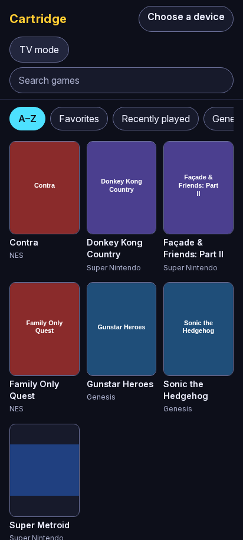
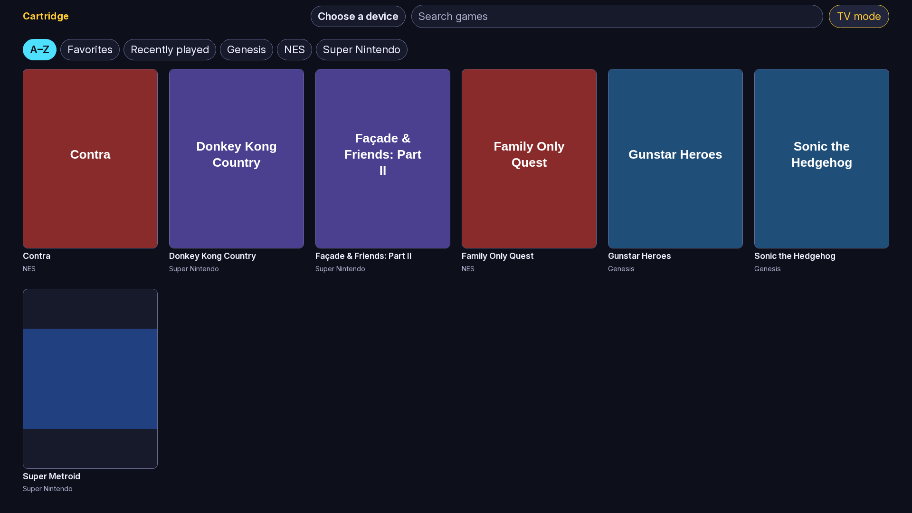

# Cartridge

Cartridge is a self-hosted web app that browses your MiSTer FPGA game library as a cover-art grid and launches games on the MiSTer you pick, through [Zaparoo Core](https://zaparoo.org). It runs on any small always-on machine on your network (an Alpine container, a Raspberry Pi, a server), indexes each device's library through Zaparoo, and works from a phone or from a TV browser with a D-pad.

- Anyone on your home network can browse, launch, return a device to the menu and star favorites, with no login. The device you are launching on is always visible, and launching onto a busy device asks first.
- From outside the house, people you allow through Cloudflare Access get the same catalog read-only. They can never launch or control a device.
- Nothing in the browser ever sees a ROM path or a device address, and no request can choose a device that isn't in your config.

Status: verified against a simulator only. [HARDWARE_VALIDATION.md](HARDWARE_VALIDATION.md) is the checklist for a real MiSTer.

## Screenshots

Both are taken from `cartridge simulate` (see the end of this file), so they show generated placeholder tiles, not real artwork.

| Phone | TV (`?tv=1`) |
|---|---|
|  |  |

## Install Zaparoo Core on a MiSTer

Zaparoo Core isn't installed on a MiSTer by default.

1. Run Update All, press UP during the countdown, turn on **Zaparoo** under **Tools & Scripts**, then SAVE.
2. Open **Scripts → zaparoo** on the MiSTer and accept starting it as a service.
3. Open `http://<mister-ip>:7497/app/` and build the media database.
4. Don't configure a Zaparoo API key.

Cartridge talks to Zaparoo Core over its documented WebSocket API, the way any LAN client does. Cartridge uses only a fixed set of read methods plus `run` and `stop`; it never uses `unsafe` or `media.generate`, so it can't change a device's settings.

## Device config

Devices live in `/etc/cartridge/devices.yaml` (override with `DEVICES_FILE`). Copy [`deploy/alpine/devices.yaml.example`](deploy/alpine/devices.yaml.example):

```yaml
devices:
  - name: family-room        # a-z, 0-9, hyphen; 1-32 characters
    label: Family Room       # shown in the UI
    model: MiSTer
    platform: mister
    transport: zaparoo
    host: 192.0.2.10
    port: 7497
    auth: legacy
  - name: office
    label: Office
    model: MiSTer
    platform: mister
    transport: zaparoo
    host: 192.0.2.11
    port: 7497
    auth: legacy
```

Validation: `name` is 1 to 32 characters from `a-z0-9-` and unique; `host` is an IP address or hostname; `port` is 1 to 65535 (default 7497); `platform` is `mister` and `transport` is `zaparoo` (Batocera isn't supported in v1); `auth` is `legacy` (`paired` isn't implemented yet). A bad entry doesn't stop the others: its card shows a sentence saying what to fix, and `cartridge check` prints the same sentences.

**`strip_prefixes`** is optional, a list of absolute path prefixes. Game identity is the system plus the path inside the system folder, so two MiSTers that share one library match up. Normally Zaparoo reports that relative path itself. If it doesn't, or your devices mount the same share at different places, list the prefixes. The longest matching prefix is removed from each absolute path, then the first remaining segment (the system folder) is dropped, so with `strip_prefixes: [/media/fat/games]` the path `/media/fat/games/SNES/a.sfc` gives `a.sfc`, and `/userdata/roms/snes/a.sfc` gives the same with `[/userdata/roms]`. When set, it overrides the relative path Zaparoo reports.

**`LAN_HOSTS`** (a setting, below) is a guard against DNS rebinding: the LAN app answers only requests whose `Host` header is on its allow-list, ignoring case and port. With a wildcard bind (`0.0.0.0`) the default list includes `localhost`, the machine's own addresses and its hostname (also as `<hostname>.local`), so `http://192.0.2.20:8770/` and `http://cartridge.local:8770/` just work. With a specific bind address the list is that address plus the same names. If you reach Cartridge by any other name (a DNS alias, a reverse proxy name on your LAN), set `LAN_HOSTS` to a comma-separated list of every name you use, for example `LAN_HOSTS=cartridge.lan,192.0.2.20`. Setting it replaces the default list.

## Deploy on Alpine

For an Alpine Linux container (for example on Proxmox) with OpenRC:

```sh
apk add git
git clone https://github.com/SDNick484/cartridge && cd cartridge
sh deploy/alpine/install.sh "$PWD"
```

`install.sh` is idempotent. It installs `python3` and `py3-pip`, creates the `cartridge` user, builds a virtualenv in `/opt/cartridge/venv`, and installs the OpenRC service. Re-running it upgrades the code and keeps your settings, devices and data; after an upgrade run `rc-service cartridge restart`. It never overwrites an existing `/etc/conf.d/cartridge` or `/etc/cartridge/devices.yaml`.

| Path | What | Owner and mode |
|---|---|---|
| `/etc/conf.d/cartridge` | settings (below) | `root:cartridge` 0640 |
| `/etc/cartridge/devices.yaml` | your MiSTers | `root:cartridge` 0640 |
| `/var/lib/cartridge/` | database and artwork cache | `cartridge` 0700 |
| `/var/log/cartridge/cartridge.log` | service output | `cartridge` |

Then edit `/etc/cartridge/devices.yaml`, check it, and start the service:

```sh
su -s /bin/sh cartridge -c '/opt/cartridge/run.sh check'
rc-update add cartridge default && rc-service cartridge start
```

The app listens on `LAN_BIND` (default `0.0.0.0:8770`). `/opt/cartridge/run.sh` loads `/etc/conf.d/cartridge` and runs `cartridge serve`; it is the one place settings are loaded, so they reach the process however OpenRC starts it. `run.sh` with an argument runs that subcommand with the same settings.

The smoke test (`deploy/alpine/smoke-test.sh`) runs the whole install in a stock `python:3.12-alpine` container against simulated devices. CI runs it as the `alpine` job.

## cloudflared and Access

The remote app is read-only and meant to sit behind Cloudflare Access. Skip this section if you only want LAN access: leave `REMOTE_ENABLED=0`, the default in the shipped `conf.d.example`.

1. In Cloudflare Zero Trust, create a **self-hosted Access application** for the hostname you will use, for example `games.example.com`, with a policy that allows the people you want. Note the team domain (`example.cloudflareaccess.com`) and the application's **AUD tag**.
2. In `/etc/conf.d/cartridge`:

   ```sh
   REMOTE_ENABLED=1
   CF_ACCESS_TEAM_DOMAIN=example.cloudflareaccess.com
   CF_ACCESS_AUD="your-aud-tag"        # the Access application's AUD tag
   REMOTE_ALLOWED_EMAILS=you@example.com    # optional: only these, on top of the policy
   ```

   Cartridge refuses to start (the whole service exits, LAN app included) if `REMOTE_ENABLED=1` and either `CF_ACCESS_*` value is missing. It checks the Access assertion itself (signature, audience, issuer, expiry and the email list), not only at Cloudflare's edge. Only `/healthz` is answered without one, and it returns no data.
3. Point cloudflared at the **remote** port:

   ```yaml
   ingress:
     - hostname: games.example.com
       service: http://<ct>:8771     # <ct> is this machine; 127.0.0.1 if cloudflared runs on it
     - service: http_status:404
   ```

   `REMOTE_BIND` defaults to `127.0.0.1:8771`. If cloudflared runs on another machine, set `REMOTE_BIND` to this machine's LAN address; the Access assertion is then the gate.

**The LAN port (8770) is never a tunnel target.** It has no login. If you point a tunnel at it by mistake it fails closed: it answers 403 to anything that arrives through a proxy.

## Settings

Set these in `/etc/conf.d/cartridge` (or the environment of `cartridge serve`).

| Setting | Default | Meaning |
|---|---|---|
| `LAN_BIND` | `0.0.0.0:8770` | Where the LAN app listens |
| `LAN_HOSTS` | the bind address and this machine's names | Comma-separated `Host` allow-list for the LAN app (see Device config) |
| `REMOTE_ENABLED` | `1` | Run the remote app; needs the two `CF_ACCESS_*` settings. The shipped `conf.d.example` sets it to `0` |
| `REMOTE_BIND` | `127.0.0.1:8771` | Where the remote app listens |
| `CF_ACCESS_TEAM_DOMAIN` | none | Your Access team domain, e.g. `example.cloudflareaccess.com` |
| `CF_ACCESS_AUD` | none | The Access application's AUD tag (comma-separate several) |
| `REMOTE_ALLOWED_EMAILS` | none | Only these emails may use the remote app |
| `DATA_DIR` | `/var/lib/cartridge` | Database and artwork cache |
| `DEVICES_FILE` | `/etc/cartridge/devices.yaml` | The device list |
| `ART_ONLINE` | `1` | `0` never fetches artwork from the internet |
| `SYNC_INTERVAL_HOURS` | `6` | How often each device's catalog is synced |
| `LOG_LEVEL` | `INFO` | `DEBUG`, `INFO`, `WARNING`, `ERROR` or `CRITICAL` |

## Artwork sources and their terms

Covers are looked up in this order and cached under `DATA_DIR/art`:

1. **Zaparoo** `media.image`, from any online device that has the game. This is free when your scraped media (for example EmulationStation `gamelist.xml` art) sits on the share. Its licensing is whatever you put there.
2. **libretro-thumbnails**: `https://thumbnails.libretro.com/<Playlist Name>/Named_Boxarts/<Name>.png`. Cartridge makes at most one request per second with the generic User-Agent `cartridge/<version>` and honors `429` and `Retry-After`. That repository has no explicit license. Cartridge serves the art only on your LAN and behind Access (never publicly) and doesn't redistribute it, but you are responsible for how you use it.
3. A **generated tile**: the title on a color per system. It is never cached as "found", so real art replaces it later.

A miss is remembered for 7 days so a missing title doesn't cost a request on every page view. Set `ART_ONLINE=0` to turn off the online sources (the libretro one) entirely. There is no ScreenScraper support and Cartridge needs no API key.

## Home Assistant

Cartridge publishes nothing to MQTT or Home Assistant. To track what each MiSTer plays in Home Assistant, run `mcp-server-misterfpga track` (the `mcp-server-misterfpga` project), which publishes now-playing and session history over MQTT.

## Troubleshooting

Run `cartridge check` first. It is read-only: it validates `devices.yaml` and the settings, tries each device, and checks the database without creating or changing anything, so it is safe to run as any user. Exit code 0 means all good. `cartridge sync` writes the database, so run both as the service user (`su -s /bin/sh cartridge -c '/opt/cartridge/run.sh check'`, and the same with `sync`; add `--device <name>` to sync one device). Running `sync` as root leaves root-owned files the service then can't write.

| You see | Cause and fix |
|---|---|
| A card says "offline" or "No answer from Office: is it on and on the network?" | The MiSTer is off or unreachable. Its games stay browsable from cache, but Play is disabled. Check the `host` and `port` in `devices.yaml` and that you can open `http://<mister-ip>:7497/app/`. |
| "Connection refused", or a sentence pointing here | Zaparoo Core isn't installed or isn't running on that MiSTer. Follow [Install Zaparoo Core on a MiSTer](#install-zaparoo-core-on-a-mister). |
| The card shows **Needs pairing**, with "<Device> needs pairing: Zaparoo's encryption is on and Cartridge can't pair yet. Turn encryption off in Zaparoo's config (see the README)." | Core requires encryption, which Cartridge doesn't support yet (`auth: paired` comes later). Turn it off on the MiSTer by setting `encryption = false` in Zaparoo Core's configuration, then restart Core. The exact file and section are unverified: check Zaparoo's documentation (see `Z-ENC-ERROR` below). |
| The grid is empty and says it hasn't been indexed | Build the media database in Zaparoo's web UI (`http://<mister-ip>:7497/app/`), then press **Sync now**. |
| A sync failed (error on the card) | The previous data is kept; nothing is marked missing from a failed run. Fix the cause (usually the device dropped off the network) and press **Sync now**, or run `cartridge sync` as the service user. Sync now is limited to once a minute per device. |
| A cover is a generated tile | No art was found. Check `ART_ONLINE`, or put art on the share for Zaparoo to serve. Misses are retried after 7 days. |
| The remote app answers 403 to everything but `/healthz` | The Access assertion is missing or doesn't match: check `CF_ACCESS_TEAM_DOMAIN`, `CF_ACCESS_AUD` and `REMOTE_ALLOWED_EMAILS`. With `REMOTE_ENABLED=1` and no Access settings Cartridge won't start at all. |
| The LAN app answers 403 | Either the request came through a proxy or tunnel (the LAN port must never be a tunnel target), or you used a name that isn't in `LAN_HOSTS`. Add it. |
| `/healthz` reports not ready, or `check` says the database can't be used | `check` names the file. Make sure `DATA_DIR` is writable by the service user. If the database is corrupt, delete it; Cartridge rebuilds it on the next sync (favorites are lost). |
| The service won't start | `cat /var/log/cartridge/cartridge.log`, or run `su -s /bin/sh cartridge -c /opt/cartridge/run.sh` to see the message in the foreground. Configuration problems are printed as sentences. |

## Assumptions

Some facts about Zaparoo Core and libretro-thumbnails are taken from documentation and haven't been verified on a real MiSTer. Each is cited in the code as `# ASSUMPTION <id>` and has a checklist in [HARDWARE_VALIDATION.md](HARDWARE_VALIDATION.md). When you verify one, change its status here.

| Id | Claim | Status |
|---|---|---|
| `Z-LEGACY` | MiSTer Core admits unauthenticated plaintext LAN clients for every allow-listed method (incl. `media.image`) | unverified |
| `Z-ENDPOINT` | `ws://<host>:7497/api/v0.1`, string ids, `ping` answered with `pong` | unverified |
| `Z-SEARCH-FIELDS` | `media.search` results carry `mediaId`, `name`, `systemId`, `path` (and maybe `relativePath`) | unverified |
| `C-RELPATH` | `relativePath` is system-folder-relative and identical across devices on one share | unverified |
| `Z-RUN-WAITS` | `run` returns after the launch, within 30 s | unverified |
| `Z-STOP-MENU` | `stop` returns the MiSTer to the menu and `media.stopped` follows | unverified |
| `Z-HISTORY-PATH` | `media.history.mediaPath` and `media.active.mediaPath` equal the indexed path | unverified |
| `Z-INDEXING` | `media.indexing` signals completion in a detectable way | unverified |
| `Z-IMAGE` | `media.image` inline returns base64 and `contentType`, and an error or empty result when there is no art | unverified |
| `Z-ENC-ERROR` | The encryption-required rejection is error code `-32002` | unverified |
| `L-THUMB-URL` | libretro-thumbnails URL and character-replacement rule | unverified |

## Try it without hardware: `cartridge simulate`

```sh
python3.11 -m venv .venv && . .venv/bin/activate && python -m pip install -e ".[dev]"
cartridge simulate        # two simulated MiSTers and a server at http://127.0.0.1:8770/
```

`simulate` starts two fake Zaparoo devices (`family-room` and `office`) with a small generated library and a server pointed at them. Options: `--dir <path>` for where it keeps its files (default `./sim-data`), `--lan-bind HOST:PORT`, and `--fakes-only` to start only the fake devices and print the path of their `devices.yaml`. It never touches a real device. Set `ART_ONLINE=0` to keep it off the internet.

For development, see [CLAUDE.md](CLAUDE.md): the verification gate is `python -m pytest && python -m ruff check . && python -m ruff format --check . && python -m mypy && python scripts/check_js.py`, and browser smoke tests run with `python -m pytest -m e2e`.

## License

MIT. Zaparoo Core is GPL-3.0; Cartridge uses only its documented protocol and copies no code from it.
